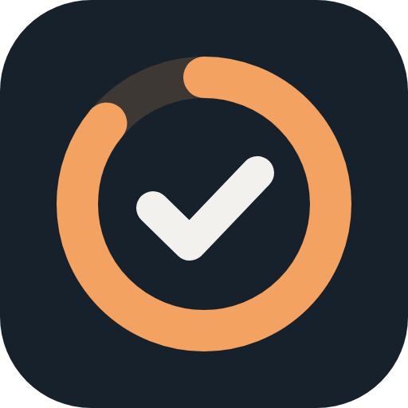
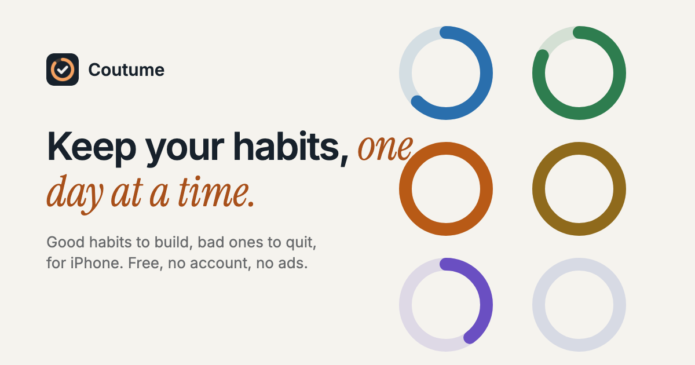

  

<h1 align="center">Coutume</h1>

<strong>Keep your habits, one day at a time.</strong>

  A habit tracker for iPhone: good habits to build, bad ones to quit, one tap to log, and Apple Health fills in the rest. No account needed.

  <a href="https://coutume.app">coutume.app</a> · <a href="https://coutume.app/fr/">Français</a>

## Two kinds of habits

Coutume doesn’t treat every habit the same way. A habit to build, like 8 glasses of water or 10,000 steps, fills its ring as the day goes. A habit to quit, like energy drinks, is kept by default: you only log the day you slip, and Coutume counts your days without, the money saved and the urges you resisted.

## What you can do

- **Log in one tap.** Tap a ring, the day is logged. Touch and hold to enter a number or undo.
- **Let Health do it.** Steps, exercise minutes, mindful minutes and water fill themselves in from Apple Health.
- **Keep your streak.** One missed day a week is forgiven, so one off day doesn’t erase weeks of effort.
- **Level up.** Eleven levels by days kept, from Good intention to Legend, and eighteen milestones to celebrate.
- **See your month.** A calendar of every day, brighter as more habits were kept, and widgets for your Home Screen.

## Private by default

No account, no sign-up, no ads. Your habits and what Coutume reads from Health are stored on your iPhone and in your private iCloud, and never sent to us.

## Download

Coutume is coming soon to the App Store, for iPhone.

---

## En français

**Tiens tes habitudes, un jour à la fois.**

Coutume est une app iPhone pour suivre tes habitudes : les bonnes à prendre, les mauvaises à laisser. Une habitude à prendre remplit son anneau au fil de la journée ; une habitude à éviter est tenue d’office, et tu ne notes que le jour où tu craques.

- **Note d’un toucher** : touche l’anneau, c’est noté.
- **Laisse faire Santé** : tes pas, ton exercice, ta pleine conscience et ton eau se notent seuls.
- **Garde ta séquence** : un jour manqué par semaine est pardonné.
- **Monte de niveau** : onze niveaux, dix-huit jalons et un calendrier de ton mois.
- **Tes habitudes restent à toi** : synchro iCloud, sans compte, sans pub, gratuite.

[coutume.app/fr](https://coutume.app/fr/)

---

Made with ♥ by <a href="https://wibeset.ca">Wibeset</a> in Canada

